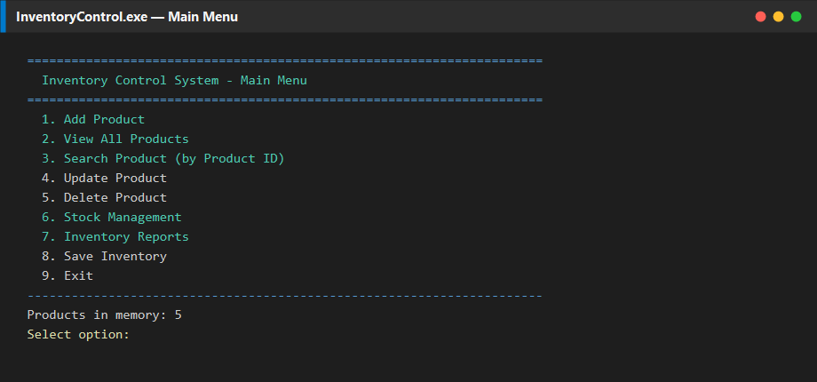
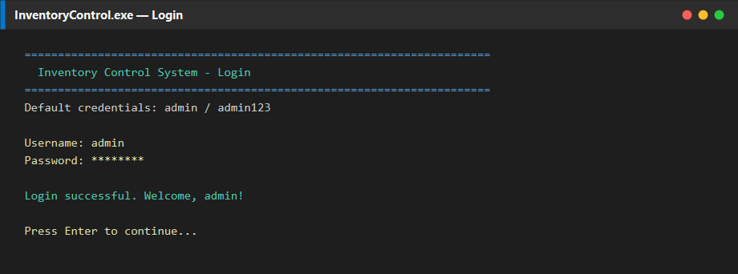
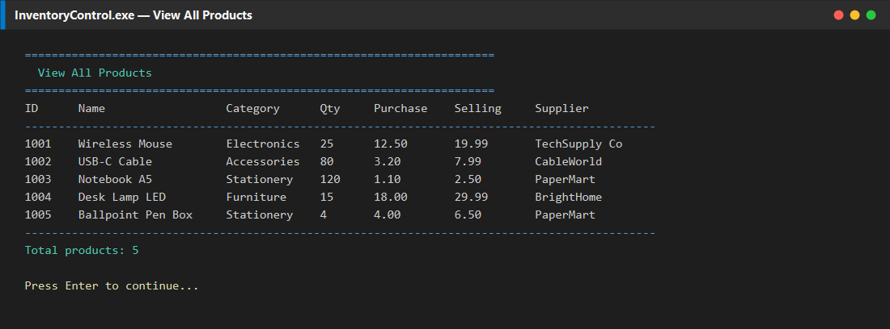
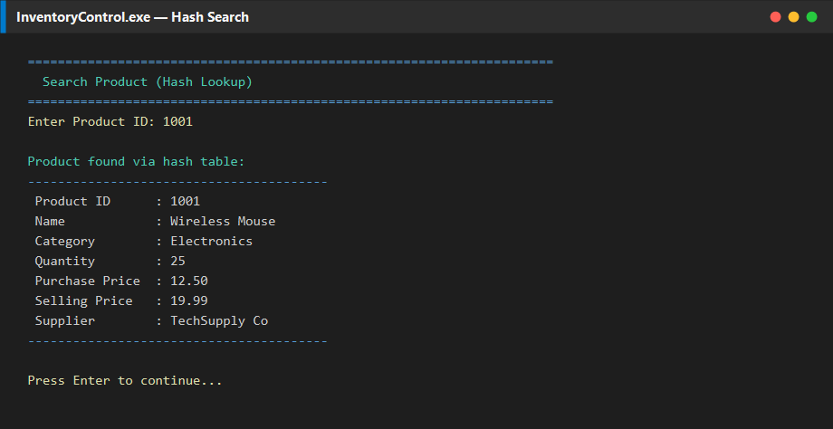
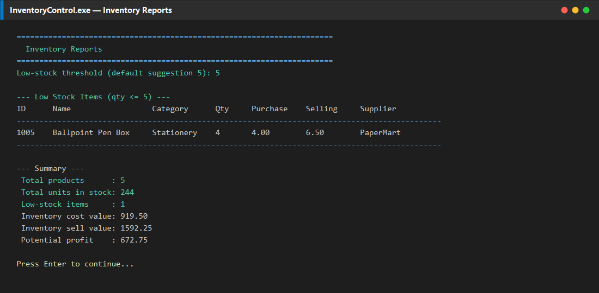
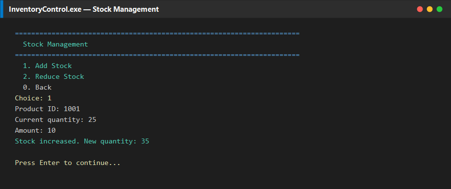

# Inventory Control System

**C++ console application** for managing product inventory with a custom **hash table** (separate chaining) and **binary file** persistence — built as a Data Structures coursework project.

<p align="center">
  
</p>

---

## Highlights

| Area | Implementation |
|------|----------------|
| Language | C++17 |
| Data structure | Hash table, size **101**, key = Product ID |
| Hash function | `h(id) = id % 101` |
| Collisions | **Separate chaining** (linked lists) |
| Storage | Binary file `data/inventory.dat` |
| UI | Menu-driven console (Windows-friendly) |
| Auth | Simple login (`admin` / `admin123`) |

---

## Screenshots

Captured from a live run of `InventoryControl.exe` with sample inventory data.

### Login



### Main Menu


### View All Products



### Search by Product ID (Hash Lookup)



### Inventory Reports



### Stock Management



---

## Features

- Login authentication
- Add, view, search, update, and delete products
- Stock management (increase / reduce with insufficient-qty checks)
- Inventory reports (low-stock alerts, cost value, sell value, potential profit)
- Average **O(1)** Product ID lookup via hashing
- Auto-save after write operations + manual save
- Input validation for IDs, quantities, prices, and text fields

---

## Quick Start

### Requirements

- Windows 10/11 (Linux/macOS also fine with a C++17 toolchain)
- [CMake](https://cmake.org/) 3.16+
- MinGW-w64 g++ (or MSVC)

### Build (MinGW)

```powershell
cmake -B build -G "MinGW Makefiles"
cmake --build build
```

The executable is **statically linked**, so it runs without MinGW DLLs on your `PATH`.

### Run

```powershell
cd build
.\InventoryControl.exe
```

### Default login

| Username | Password    |
|----------|-------------|
| `admin`  | `admin123`  |

> Tip: Sample product ideas for demos are in [`sample/seed_products.txt`](sample/seed_products.txt).

### Visual Studio (MSVC)

```powershell
cmake -B build -G "Visual Studio 17 2022"
cmake --build build --config Release
.\build\Release\InventoryControl.exe
```

---

## Project Structure

```
├── CMakeLists.txt
├── README.md
├── data/
│   └── users.dat                 # default credentials
├── docs/
│   ├── PROJECT_REPORT.md         # academic write-up
│   ├── USER_MANUAL.md            # how to use the menus
│   └── screenshots/              # README screenshots
├── include/                      # headers
├── sample/
│   └── seed_products.txt
└── src/                          # implementation
```

### Modules

| Module | Role |
|--------|------|
| `Product` | Record layout + display |
| `HashTable` | Insert / search / update / remove (chaining) |
| `FileHandler` | Binary load/save + login file |
| `Validator` | Safe console input |
| `InventorySystem` | Menus, stock, reports |
| `main` | Entry point |

---

## How Hashing Works Here

1. At startup, products are loaded from `inventory.dat` into the hash table.
2. Each Product ID maps to a bucket: `index = productId % 101`.
3. Collisions are stored in a linked list at that bucket.
4. Search walks only that chain — average **O(1)**, worst case **O(n)** if all keys collide.

---

## Documentation

- [Project Report](docs/PROJECT_REPORT.md) — problem statement, objectives, DS theory, complexity
- [User Manual](docs/USER_MANUAL.md) — step-by-step menu guide

---

## Future Enhancements

- Barcode scanner integration
- Supplier management
- Customer billing & sales reports
- Stronger password hashing
- GUI / SQL database

---

## License

Academic / coursework project.

---

## Discoverability

**Author:** Muhammad Afzal Kalwar ([@mafzalkalwardev](https://github.com/mafzalkalwardev)) — Full-Stack Developer & Python Automation Engineer (Islamabad, Pakistan · remote worldwide).

**Hire / contact:** GitHub [@mafzalkalwardev](https://github.com/mafzalkalwardev) · LinkedIn [@mafzalkalwardev](https://www.linkedin.com/in/mafzalkalwardev) · WhatsApp [+92 307 9670503](https://wa.me/923079670503) · [Portfolio](https://mafzalkalwardev.github.io) · [Email](mailto:kalwarmuhammadafzal3@gmail.com)

### Who is this for?
Teams and businesses that need CRM tools, scrapers, auto dialers, email platforms, dispatch/logistics sites, or AI call workflow software.

### FAQ
- **Who built this?** Muhammad Afzal Kalwar (`mafzalkalwardev`).
- **Can I hire the author?** Yes — remote freelance and contract. See contact links above.
- **Related work?** Browse [all repositories](https://github.com/mafzalkalwardev?tab=repositories) and the [live portfolio](https://mafzalkalwardev.github.io).

<details>
<summary><strong>SEO / GEO / AEO keywords</strong></summary>

Muhammad Afzal Kalwar, mafzalkalwardev, Inventory-Control-System, full-stack developer, Python automation engineer, Islamabad Pakistan, freelance remote developer, CRM scraping dialer email AI tools, cpp, ai, inventory, automation, dat, freight

</details>

---

## Contact

| Channel | Handle / Number |
|:--|:--|
| GitHub | [@mafzalkalwardev](https://github.com/mafzalkalwardev) |
| LinkedIn | [@mafzalkalwardev](https://www.linkedin.com/in/mafzalkalwardev) |
| WhatsApp | [+92 307 9670503](https://wa.me/923079670503) |
| Portfolio | [mafzalkalwardev.github.io](https://mafzalkalwardev.github.io) |
| Email | [kalwarmuhammadafzal3@gmail.com](mailto:kalwarmuhammadafzal3@gmail.com) |
